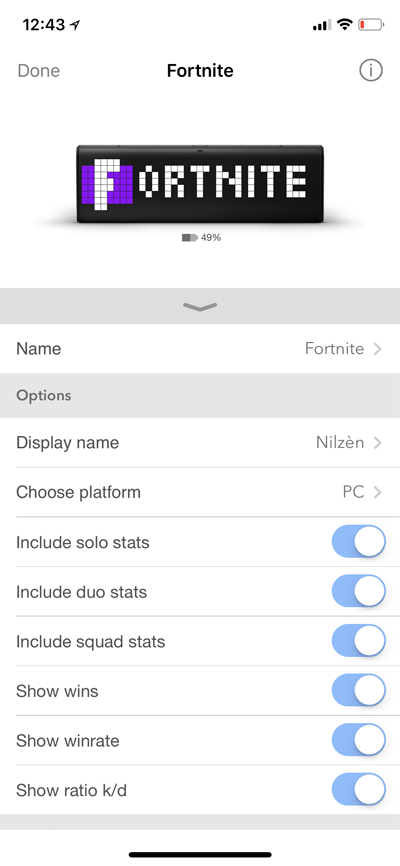

# Fortnite stats for LaMetric

# How it works ?

- Launch your LaMetric app
- Install the app ["Fortnite"](https://apps.lametric.com/apps/fortnite/6390)
- Configure parameters, the following are mandatory:
  - "Display name"
  - "API Key" for [www.api-fortnite.com](www.api-fortnite.com)

# Feedback

If you need help, [create an issue](https://github.com/pgrimaud/lametric-fortnite/issues) or contact us on [Twitter](http://twitter.com/pgrimaud_)

# Run locally

1. Copy [config/parameters.php.dist](config/parameters.php.dist) to [config/parameters.php](config/parameters.php).
2. Update `config/parameters.php` with a valid `player` name and `api_key` for [www.api-fortnite.com](www.api-fortnite.com). `sentry_key` can be left empty.
3. Install dependencies with `composer install`.
4. Start a local PHP server from the project root:
   `php -S 127.0.0.1 -t public`
5. Open `http://127.0.0.1/` in your browser.

# More info

Based on [api-fortnite.com](https://api-fortnite.com)
